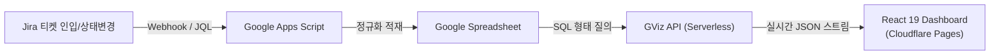

# Jira Analytics Dashboard
> **Jira 결함 라이프사이클 표준화 및 Zero-Cost 실시간 품질 모니터링 대시보드**

[](https://jira-analytics.pages.dev)
[](https://react.dev/)
[](https://vitejs.dev/)
[](https://pages.cloudflare.com/)

---

## 📌 바로가기
- 🌐 **Jira Analytics 웹 대시보드**: [https://jira-analytics.pages.dev](https://jira-analytics.pages.dev)

---

## 1. 개요 (Overview)
프로젝트 전반의 결함 현황과 품질 지표를 **투명하게 공유하고 효율적으로 관리하기 위해 구축한 실시간 모니터링 대시보드**입니다.  
별도의 DB 서버나 유료 라이선스 없이 **Google Spreadsheet 및 GViz API를 연계한 Serverless 파이프라인**을 설계하여 인프라 비용 0원으로 실시간 동기화를 구현했습니다.

### 핵심 해결 포인트
- **품질 현황 투명화**: 별도 도구 설치 없이 웹 링크로 프로젝트의 결함 상태와 품질 추이를 직관적으로 확인
- **수동 집계 공수 제거**: 엑셀로 Jira 데이터를 추출해 수식으로 집계하던 반복 작업 자동화
- **결함 추이 및 재오픈 추적**: 재오픈율(Reopen Rate)과 처리 소요일수를 추적하여 지속적인 품질 개선에 활용
- **데이터 보안 마스킹**: 외부 포트폴리오 공개를 위한 민감 이슈 데이터 비식별화 및 UI 블러 처리

---

## 2. 데이터 파이프라인 구조



---

## 3. 주요 모니터링 지표 (데이터 심층 분석)

1. **전체 개요 (`MainPage`)**: 연도별 총 이슈, 해결 완료, 잔여 이슈 요약 및 월별 유입/해결 추이 콤보 차트
2. **필터 세부 통계 (`DetailedStatsPage`)**:
   - **재오픈율(Reopen Rate)**: 결함 수정의 완성도 및 반복 재발 이슈 추적
   - **해결 소요일수(Lead Time)**: 결함 우선순위(Highest ~ Lowest)별 평균 처리 기간 및 병목 컴포넌트 식별
   - 5종 다차원 연동 필터 (연도, 릴리즈 버전, 담당자, 이슈 유형, 상태)
3. **역할별 기여도 (`MemberStatsPage`)**: 역할군별(기획/개발/QA) 처리 비중 및 평균 해결 소요일수 비교
4. **릴리즈 버전 분석 (`RoadmapPage`)**: 릴리즈 버전별 작업량 및 버전 완료율 추적

---

## 4. 로컬 환경 실행

<details>
<summary><b>로컬 실행 방법 펼치기 (Quick Start)</b></summary>

```bash
# 저장소 클론 및 패키지 설치
git clone https://github.com/Chera-Kang/JiraAnalytics.git
cd JiraAnalytics
npm install

# 환경 변수 설정 (.env.example 복사 후 구글 시트 ID 입력)
cp .env.example .env

# 로컬 개발 서버 구동 (http://localhost:5173)
npm run dev
```
</details>
